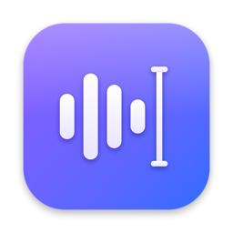
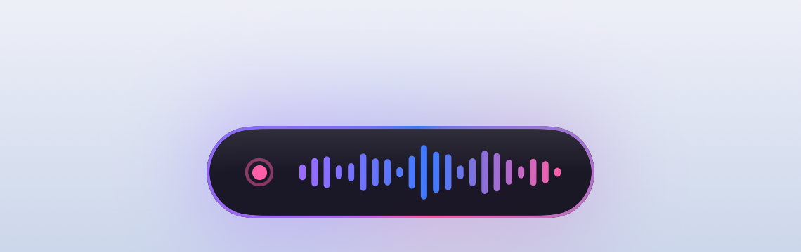
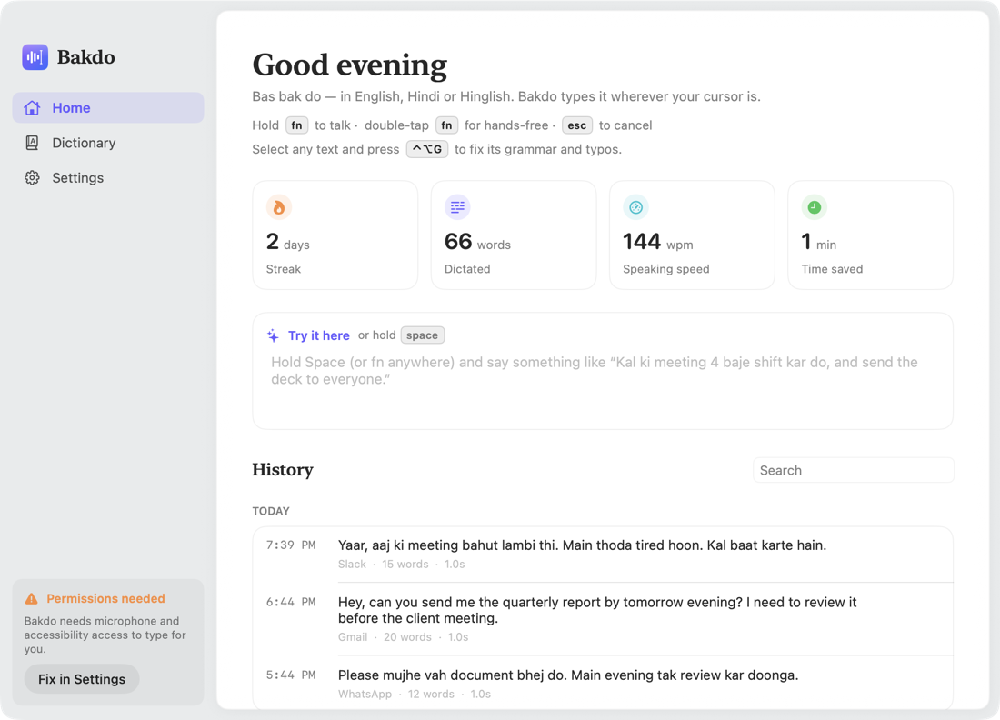

<p align="center">
  
</p>

<h1 align="center">Bakdo</h1>

<p align="center">
  <b>Bas bak do.</b> Hold a key, speak in English, Hindi or Hinglish, and Bakdo types it, with grammar fixed, into any app on your Mac.<br>
  100% on-device. No account, no cloud, works offline.
</p>

<p align="center">
  
</p>

---

Bakdo is a free, open-source voice dictation app for macOS, in the spirit of Wispr Flow and Typeless, built for how Indians actually talk. It understands code-mixed Hinglish ("kal ki meeting 4 baje shift kar do, and send the deck to everyone"), writes Hindi in Roman script the way you'd type it in chat, and polishes the result with a small local language model before pasting it where your cursor is.

## Features

- **Dictate anywhere.** Hold <kbd>fn</kbd>, speak, release. Text appears in whatever text box has focus: Slack, Gmail, Notion, VS Code, Claude, WhatsApp Web, and so on.
- **English, Hindi and Hinglish in one model.** No language switch to flip. English stays English, and Hindi comes out as natural Hinglish ("Main thoda tired hoon").
- **Auto grammar and typo fix.** Every dictation is cleaned up by an on-device LLM. "we was thinking" becomes "we were thinking". Hinglish is never translated, numbers are never changed, and questions you dictate are never answered.
- **Fix any selected text.** Select text in any app and press <kbd>⌃⌥G</kbd>; Bakdo corrects it in place.
- **Hands-free mode.** Double-tap <kbd>fn</kbd> to keep listening, tap again to finish. <kbd>esc</kbd> cancels.
- **Your words, spelled right.** A Dictionary of names and jargon, plus replacement rules and snippets ("my email" → `you@company.com`).
- **Voice training.** Read sentences aloud to measure how well Bakdo understands your accent, see your most misheard words, and fix them in one click. The recordings are training data for a personal fine-tune.
- **Native and light.** A Swift/SwiftUI app with whisper.cpp and llama.cpp on Metal. About 1.8 s from releasing the key to the text appearing on an M1 Pro, and no CPU use while idle.

<p align="center">
  
</p>

## Requirements

| | |
|---|---|
| Mac | Apple Silicon (M1 or newer) |
| macOS | 14 Sonoma or newer |
| Tools | Xcode Command Line Tools with Swift 6 (`xcode-select --install`). Full Xcode is **not** needed |
| Disk | ~2 GB (app 22 MB + speech model 0.6 GB + writing model 1.3 GB) |
| RAM | 8 GB minimum, 16 GB+ recommended |

## Install

```bash
git clone https://github.com/nikkuAg/bakdo.git
cd bakdo
./scripts/install.sh
```

That one script checks your Mac, downloads the two pinned runtime frameworks (checksum-verified), builds `Bakdo.app`, copies it to `/Applications` and opens it. On first launch Bakdo walks you through permissions and downloads the speech models (~1.9 GB, resumable, checksum-verified).

Step-by-step instructions, updating, uninstalling and troubleshooting are in **[docs/INSTALL.md](docs/INSTALL.md)**.

### After installing

1. **Grant Microphone and Accessibility** when the welcome screen asks. Accessibility is what lets Bakdo detect the shortcut and type into other apps.
2. **Set the Globe key to do nothing:** System Settings › Keyboard › *Press 🌐 key to* → **Do Nothing**. Otherwise macOS opens the emoji picker every time you dictate. (Or pick another dictation key in Bakdo's Settings.)
3. Click into any text box, hold <kbd>fn</kbd> and say something.

## Using Bakdo

| Action | How |
|---|---|
| Dictate | Hold <kbd>fn</kbd>, speak, release |
| Hands-free | Double-tap <kbd>fn</kbd>, speak, tap <kbd>fn</kbd> to finish |
| Cancel | <kbd>esc</kbd> while listening |
| Fix selected text | Select text, press <kbd>⌃⌥G</kbd> (changeable in Settings) |
| Try it inside Bakdo | Hold <kbd>space</kbd> on the Home screen |
| New line / paragraph | Say "new line" or "new paragraph" |
| Paste last transcript | Menu bar icon › Paste Last Transcript |

<p align="center">
  
  
</p>

## How it works

```
 hold fn ─► AudioRecorder (16 kHz mono) ─► trim silence + normalise
        ─► Whisper large-v3-turbo · Hinglish fine-tune (whisper.cpp, Metal)
        ─► clean-up: fillers, "new line", hallucination filter
        ─► Qwen3.5 2B grammar fix (llama.cpp, Metal) + safety guards
        ─► Dictionary replacements ─► paste into the focused app (clipboard restored)
```

| Model | Job | Size | Source |
|---|---|---|---|
| Whisper large-v3-turbo, Hindi2Hinglish-Apex fine-tune (q5_1) | Speech → text for English, Hindi and Hinglish | 624 MB | [Oriserve](https://huggingface.co/Oriserve/Whisper-Hindi2Hinglish-Apex), GGML by [voquill](https://huggingface.co/voquill/whisper-hindi2hinglish-apex-ggml) |
| Qwen3.5 2B Instruct (Q4_K_M) | Grammar, spelling and punctuation fixes | 1.28 GB | [Qwen](https://huggingface.co/Qwen/Qwen3.5-2B), GGUF by [unsloth](https://huggingface.co/unsloth/Qwen3.5-2B-GGUF) |

The grammar model was picked after testing Qwen3.5 0.8B (missed about half the fixes), LFM2.5 1.2B (mangled Hinglish) and a 3-bit Qwen3.5 2B (occasionally dropped words). Its output is only used when it keeps the original words, numbers and script. Otherwise Bakdo types exactly what you said.

## Privacy

Everything runs on your Mac. Audio is only captured while you hold the key and is discarded after transcription, unless you opt in to keeping it for Voice training. History, recordings and models live in `~/Library/Application Support/Bakdo`. The only network traffic is the one-time model download from Hugging Face.

## Development

```
Sources/Bakdo/
  App/    Entry point, AppDelegate (menu bar, windows), debug modes, snapshots
  Core/   WhisperEngine, LlamaEngine, DictationController, HotkeyMonitor, TextInserter,
          TextCorrector, ModelManager (chunked downloader), training data + accuracy
  UI/     SwiftUI: floating pill overlay, Home, Dictionary, Voice training, Settings, onboarding
design/   App icon source (SVG) + AppIcon.icns
scripts/  setup.sh, build-app.sh, install.sh
```

```bash
./scripts/setup.sh                 # once: toolchain check + frameworks
swift build -c release             # compile
./scripts/build-app.sh --install   # bundle, sign (ad-hoc), install to /Applications
```

Built-in debugging modes (run the binary directly):

```bash
B=.build/release/Bakdo
$B --transcribe [--fix] clip.wav …      # speech (+ grammar) on audio files, with timings
$B --correct model.gguf ["text" …]      # grammar model on sample sentences
$B --snapshot <dir>                      # render every screen (light + dark) to PNG
$B --pills <dir>                         # render each state of the listening pill
```

> **Note on rebuilding:** builds are ad-hoc signed, so macOS treats every new build as a new app and resets its Accessibility permission. After installing a new build, remove Bakdo from System Settings › Privacy & Security › Accessibility with **−** and grant it again.

## Credits and licenses

Bakdo is released under the [MIT License](LICENSE).

It builds on [whisper.cpp](https://github.com/ggml-org/whisper.cpp) and [llama.cpp](https://github.com/ggml-org/llama.cpp) (MIT), OpenAI's [Whisper](https://github.com/openai/whisper) (MIT), Oriserve's [Whisper-Hindi2Hinglish-Apex](https://huggingface.co/Oriserve/Whisper-Hindi2Hinglish-Apex) (Apache 2.0) and Alibaba's [Qwen3.5](https://huggingface.co/Qwen/Qwen3.5-2B) (Apache 2.0). Models are downloaded at runtime and are not redistributed in this repository.
